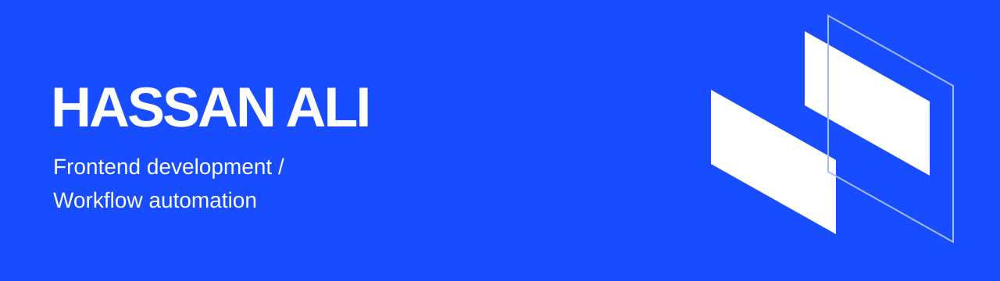

## Building interfaces and useful automations.

I’m Hassan Ali, a BS Artificial Intelligence student at NUML. I build frontend projects and workflow automations while developing my skills through practical work.

**React · JavaScript · HTML · CSS · Python · n8n**

### Selected work

| Project | Description | Explore |
| --- | --- | --- |
| Aura Coffee | Coffee storefront frontend | [Live demo](https://aura-coffee-frontend.vercel.app) |
| Task Tracker | TypeScript task-tracking project | [Source](https://github.com/hassan51214786/task-tracker-ts) |
| NulAstra | My automation agency website | [Website](https://nulastra.pro) |
| Frontend experiments | Dashboards, WebGL, Canvas, and accessibility demos | [Repository](https://github.com/hassan51214786/hassan-portfolio) |

Open to remote frontend and automation opportunities.

### Frontend experiments in this repository

| Demo | Focus | Source |
| --- | --- | --- |
| Portfolio | Responsive React portfolio | [root-showcase](./root-showcase) |
| SynthOS.Admin | Dashboard with generated data | [synthos](./synthos) |
| M-Series showcase | Scroll-driven WebGL scene | [bmw-experience](./bmw-experience) |
| A11y Primitives | Keyboard navigation and dialog focus | [a11y-primitives](./a11y-primitives) |
| Orb | Canvas particles and pointer interaction | [orb](./orb) |

### Run locally

Each folder is a separate project. To run the portfolio:

```bash
git clone https://github.com/hassan51214786/hassan-portfolio.git
cd hassan-portfolio/root-showcase
npm install
npm run dev
```

To build: `npm run build`. Static hosting uses root directory `root-showcase`, build command `npm run build`, and output directory `dist`.

Portfolio thumbnail illustrations are design concepts. Open the project links to see the actual work. SynthOS uses generated data.

### GitHub profile setup

The [profile README](./profile/README.md) and [banner](./profile/assets/banner.svg) are ready to copy into a public repository named `hassan51214786`. Put the README at that repository’s root, with the banner at `assets/banner.svg`.
